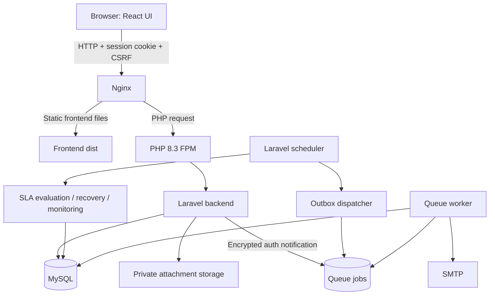
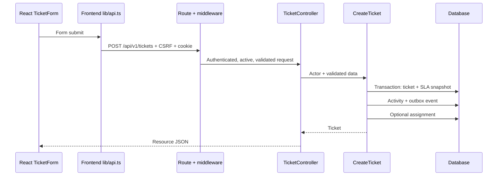
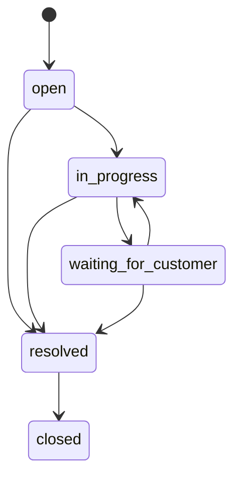
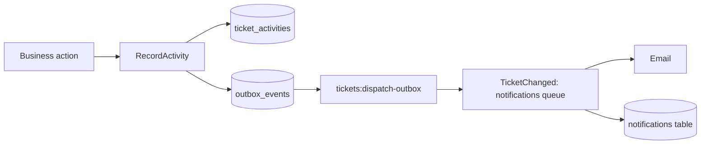
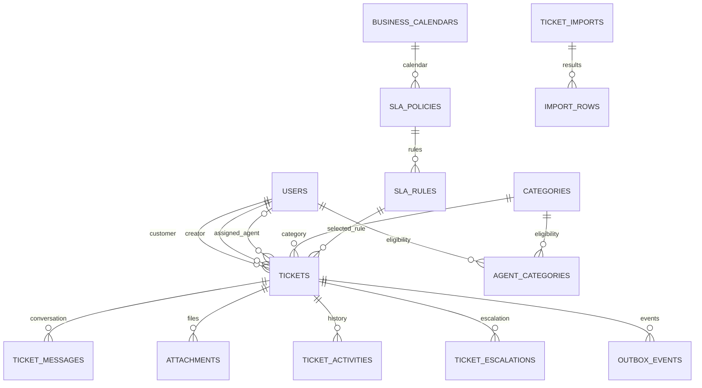

# Support Ticket & SLA — Architecture Guide

এই guide বর্তমান backend source এবং পাশের `support_ticket_front` frontend source দেখে লেখা। এখানে বাস্তব password বা secret রাখা হয়নি। VPS configuration-এর তথ্য আগের দেওয়া Nginx output থেকে নেওয়া; live server নতুন করে inspect করা হয়নি।

## 1. Project কী করে?

Customer support ticket খুলে। উপযুক্ত agent ticket পায়, conversation চালায় এবং resolve করে। Administrator agent, category, SLA policy ও CSV import পরিচালনা করে। System ticket-এর deadline হিসাব করে, warning/breach শনাক্ত করে এবং activity history ও notification রাখে।

তিনটি role:

| Role | মূল কাজ |
| --- | --- |
| Customer | নিজের ticket তৈরি, দেখা, reply, resolved ticket close |
| Agent | category অনুযায়ী available ticket দেখা/claim, assigned ticket reply ও resolve |
| Admin | ticket management, assignment, agent/category/SLA/import management |

## 2. পুরো system এক নজরে



Backend একটি domain-based monolith: একটি Laravel application-এর মধ্যে business area অনুযায়ী code ভাগ করা। আলাদা microservice নয়। Frontend আলাদা React project; API দিয়ে backend-এর সঙ্গে কথা বলে।

## 3. Technology এবং project location

| অংশ | Technology / location |
| --- | --- |
| Backend | PHP 8.3, Laravel 13; installed version আগের inspection-এ 13.35.0 |
| Frontend | React 19, TypeScript, React Router 7, Vite 8, Tailwind CSS 4 |
| Database | MySQL deployment; test connection `phpunit.xml` অনুযায়ী |
| Authentication | Laravel session cookie; bearer/JWT token flow নয় |
| Background work | Laravel queues, scheduler, durable outbox |
| Backend local | `E:/laragon/www/SUPPORT_TICKET` |
| Frontend local | `E:/laragon/www/support_ticket_front` |
| VPS backend | `/var/www/support-ticket-api` |
| VPS backend web root | `/var/www/support-ticket-api/public` |
| VPS frontend root | দেওয়া Nginx output-এ `/var/www/Assistly_front/dist` |

Package requirement এবং installed version এক জিনিস নয়। বর্তমান exact PHP package version দেখতে `composer show --direct`; frontend version requirement দেখতে frontend `package.json`।

## 4. Backend folder map

```text
app/
├── Domain/
│   ├── Auth/Services/           Email verification / password reset code
│   ├── Tickets/
│   │   ├── Actions/            Ticket create/update/status/message/attachment/import
│   │   ├── Enums/              TicketStatus, TicketPriority
│   │   ├── Queries/            Ticket search এবং visibility scope
│   │   └── Services/           CSV processing, recovery-related processing, health
│   ├── Assignment/Actions/     Agent create/update, claim/manual/auto assignment
│   ├── SLA/Services/           Business-hour deadline, evaluation, policy publishing
│   └── Audit/Services/         Activity record এবং notification outbox creation
├── Http/
│   ├── Controllers/           HTTP input থেকে domain action/service call
│   ├── Requests/              Request validation এবং authorization
│   ├── Resources/             API response-এর public shape
│   └── Middleware/            Active-user guard
├── Models/                    Database entities এবং relationships
├── Policies/                  Ticket access rules
├── Notifications/             Auth email এবং queued ticket notifications
├── Jobs/                      Queue-তে ticket import processing
├── Console/Commands/          SLA, outbox, import recovery/retry, monitoring
└── Providers/                 Gate/policy এবং rate limiter registration

routes/backend.php             /api/v1 endpoints
routes/web.php                 Web routes; backend.php load করে
routes/console.php             Scheduled commands
routes/channels.php            Private broadcast channel authorization
database/migrations/           Database schema
database/seeders/              Initial categories/SLA/admin bootstrap
tests/Feature/                 Business behavior এবং regression tests
config/support.php             Project-specific configuration
```

## 5. একটি request কীভাবে চলে?

উদাহরণ: customer ticket create করে।



প্রতিটি layer-এর দায়িত্ব:

| Layer | কী রাখবে | উদাহরণ |
| --- | --- | --- |
| Route | URL, HTTP method, middleware | `routes/backend.php` |
| Request | Valid field, format, field-level rules | `CreateTicketRequest` |
| Controller | HTTP workflow connect করা | `TicketController` |
| Action / Service | Business decision, transaction | `CreateTicket`, `AssignTicket` |
| Model | Data access, cast, relation | `Ticket`, `User` |
| Policy / Gate | কে কোন operation করতে পারবে | `TicketPolicy` |
| Resource | Client কোন fields পাবে | `TicketResource` |

Controller bypass করেও কিছু domain action authorization করে। তাই শুধু frontend button hide করলেই permission enforce হয় না; backend rules মূল authority।

## 6. Authentication এবং email code

মূল files: `AuthController`, `AuthenticationCodeService`, `AuthenticationCodeNotification`, `User`, frontend `providers/auth.tsx` ও `lib/api.ts`।

### Registration

1. `POST /api/v1/register`: name, email, password, password_confirmation নেয়। Password minimum 12 characters; client role পাঠাতে পারে না।
2. Customer user তৈরি হয়; তখনও email verified নয়।
3. ছয় digit code generate হয়। `authentication_codes` table-এ keyed HMAC hash রাখা হয়; validity **15 minutes**। একই purpose-এ resend cooldown 60 seconds; পাঁচবার ভুল code দিলে নতুন code প্রয়োজন।
4. `AuthenticationCodeNotification` encrypted queue job হিসেবে commit-এর পরে dispatch হয়। `notifications` queue worker SMTP দিয়ে পাঠায়; expired/replaced code delivery skip হয়।
5. `POST /api/v1/verify-email`: email + registration code check করে।
6. Valid হলে database transaction/row lock-এর মধ্যে code delete ও `email_verified_at` update হয়; তারপর login এবং session regenerate হয়।

### Login

`POST /api/v1/login` email/password এবং active status check করে। তারপর `email_verified_at` check করে। সফল হলে session regenerate হয়। `/me` current user দেয়; logout session invalidate করে।

### Forgot password

1. `POST /api/v1/forgot-password`: existing user হলে password-reset code পাঠায়।
2. Unknown email হলেও একই generic success message দেয়; account existence প্রকাশ করে না।
3. `POST /api/v1/reset-password`: email, code, password, password_confirmation নেয়।
4. Transaction-এ code consume করে password hash এবং remember token বদলায়। Database session driver হলে existing user sessions delete হয়; protected routes-এ `auth.session` password-hash change enforce করে।

Registration ও password-reset code-এর purpose আলাদা। Reset code দিয়ে registration verify হয় না। নতুন code issue করলে একই email/purpose-এর আগের code replace হয়। Cache clear করলে database OTP হারায় না। Password reset নিজে `email_verified_at` set করে না।

### Session + CSRF

API routes `routes/web.php` দিয়ে load হয়। তাই state-changing request-এ session cookie ও CSRF token দরকার। Frontend `lib/api.ts` প্রথমে `/csrf-token` থেকে token নেয় এবং mutation-এ `X-CSRF-TOKEN` header পাঠায়। Login/logout-এর পরে token cache clear হয়।

`401` সাধারণত session নেই; `419` সাধারণত CSRF/session mismatch। API prefix থাকলেই route stateless হয় না।

## 7. Ticket lifecycle এবং assignment



`TicketStatus` valid transition নির্ধারণ করে। `ChangeTicketStatus` policy check, transaction, row lock, timestamp ও activity update করে। `resolved` ও `closed` inactive; অন্য তিনটি active। বর্তমান transition table-এ reopen নেই।

`CreateTicket`:

- Active category ও customer validate করে। Admin অন্য customer-এর জন্য ticket খুলতে পারে।
- Priority অনুযায়ী active SLA rule নেয়।
- Ticket-এর জন্য calendar snapshot, target, start, warning ও deadline save করে।
- ID থেকে `TKT-YEAR-000001` ধরনের ticket number তৈরি করে।
- Activity/outbox লেখে এবং configured হলে auto-assign করে।

`AssignTicket`:

- Auto assignment active, available এবং category-eligible agents নেয়।
- Active-ticket workload কম এমন agent বেছে নেয়; ID order tie handling deterministic রাখে।
- Agent claim এবং admin manual assignment আলাদা policy ব্যবহার করে।
- Transaction এবং row lock concurrent claims/assignments সামলায়; unavailable ticket claim করলে conflict হয়।

## 8. SLA কীভাবে কাজ করে?

SLA হলো priority অনুযায়ী allowed resolution time। `SlaDeadlineCalculator` business calendar-এর working hours, timezone ও exceptions ধরে deadline হিসাব করে। Calendar snapshot ticket-এ থাকে, ফলে calendar পরে বদলালেই পুরোনো ticket-এর saved calendar বদলায় না।

| File | দায়িত্ব |
| --- | --- |
| `SlaDeadlineCalculator` | Working-time calculation এবং calendar snapshot |
| `PublishSlaPolicy` | SLA policy publication workflow |
| `SlaEvaluationService` | Active ticket warning/breach detection |
| `CheckTicketSla` | Evaluation-এর Artisan entry point |

Scheduler প্রতি মিনিটে `tickets:check-sla` চালায়। Evaluation ticket lock করে, একই cycle/level escalation আগে আছে কিনা দেখে, warning/breach লেখে। Breach হলে `sla_breached_at` save করে। `ticket_escalations`-এর unique constraint duplicate escalation আটকাতে সাহায্য করে। SLA activity internal; notification recipient selection-এ active admins অন্তর্ভুক্ত হয়।

Waiting-for-customer status এখনও active; ওই status-এ গেলেই SLA automatically pause হয়—এমন ধারণা করবেন না।

## 9. RecordActivity, outbox এবং notifications

আপনার open file `app/Domain/Audit/Services/RecordActivity.php` দুই কাজ করে:

1. `ticket_activities`-এ actor, action, old/new values, visibility লেখে।
2. Notification দরকার হলে recipient IDs দিয়ে `outbox_events` row বানায়।

Public activity সাধারণত customer ও assigned agent-এর জন্য; internal activity customer বাদ দেয়। Actor সাধারণত নিজের notification পায় না, তবে customer-এর ticket-created event exception। SLA event-এ admins যুক্ত হয়।



Outbox dispatcher প্রতি মিনিটে pending event পড়ে এবং queued notification dispatch করে। `TicketChanged` পাঠানোর আগে বর্তমান user access আবার check করে। এটি mail ও custom database channel ব্যবহার করে। Queue retries/backoff আছে। Outbox থাকা মানেই exactly-once email delivery guaranteed—এমন নয়; retries ও delivery behavior আলাদা concern।

## 10. CSV import, attachment এবং conversation

CSV import flow: `ImportController` → `StartTicketImport` → `ProcessTicketImport` job → `TicketImportProcessor` / `TicketCsvReader` → `ImportTicketRow`।

- Queue name `imports`; job timeout 900 seconds, tries 3।
- Overlap middleware একই import একসঙ্গে process হওয়া কমায়।
- `ticket_imports` overall state, `import_rows` row result track করে।
- Source-system + external-ticket-ID unique pair duplicate imported ticket আটকাতে সাহায্য করে।
- `tickets:recover-imports` stale work recovery; `RetryTicketImport` manual retry command।

Conversation: `ConversationController` → `AddTicketMessage`। Public reply ও internal note visibility আলাদা; customer internal note পায় না।

Attachment: `AttachmentController` → `UploadTicketAttachment`। Private disk-এ file থাকে; download authorized controller দিয়ে হয়। Public storage URL বানিয়ে private attachment expose করা উচিত নয়।

## 11. Database map

| Table | কী রাখে |
| --- | --- |
| `users` | Customer/agent/admin, credentials, active/available/verified state |
| `categories` | Ticket categories |
| `agent_categories` | Agent ↔ category many-to-many mapping |
| `business_calendars` | Working hours, timezone, exceptions |
| `sla_policies`, `sla_rules` | Policy version এবং priority-specific target |
| `tickets` | Customer, creator, agent, status, SLA snapshot/deadlines |
| `ticket_messages` | Public/internal conversation |
| `attachments` | File metadata ও storage reference |
| `ticket_activities` | Audit trail |
| `ticket_escalations` | SLA warning/breach events |
| `ticket_imports`, `import_rows` | Import state এবং row outcomes |
| `outbox_events` | Pending notification events |
| `notifications` | User notification inbox |
| `authentication_codes` | Per-user/purpose OTP hash, expiry এবং attempt count |
| `support_locks` | Shared coordination row |
| `sessions`, `cache`, `jobs`, related framework tables | Session/cache/queue infrastructure |



এটি প্রধান logical relationship map; exact nullable/foreign-key behavior migration-এ দেখুন। `customer_id` হলো কার ticket, `created_by` হলো কে তৈরি করেছে—admin on-behalf creation-এ দুইজন আলাদা হতে পারে।

## 12. API map

সব path-এর আগে `/api/v1` যোগ হবে। Exact route list-এর source `routes/backend.php`।

| Area | Method এবং path |
| --- | --- |
| CSRF | `GET /csrf-token` |
| Auth | `POST /register`, `/login`, `/verify-email`, `/resend-verification`, `/forgot-password`, `/reset-password` |
| Session | `GET /me`, `POST /logout` |
| Tickets | `GET/POST /tickets`, `GET/PATCH /tickets/{ticket}` |
| Ticket actions | `POST /tickets/{ticket}/claim`, `/assign`, `/resolve`, `/close`, `/status` |
| Conversation | `GET/POST /tickets/{ticket}/messages` |
| Files | `GET/POST /tickets/{ticket}/attachments`, `GET /attachments/{attachment}/download` |
| History | `GET /tickets/{ticket}/activities` |
| Dashboard | `GET /dashboard`, `GET /categories` |
| Notifications | `GET /notifications`, `/notifications/unread-count`, `PATCH /notifications/{id}/read`, `POST /notifications/read-all` |
| Admin | Health, customers, agents, categories, SLA policies, imports under `/admin` |

Auth endpoints guest + login throttle group-এ। Protected endpoints auth + active-user + support throttle ব্যবহার করে। Admin endpoints অতিরিক্ত `can:administer-support` Gate check করে।

## 13. Frontend architecture

| File / folder | দায়িত্ব |
| --- | --- |
| `src/main.tsx` | Application/provider bootstrap |
| `src/App.tsx` | Lazy-loaded routes, protected/admin route wrappers |
| `src/providers/auth.tsx` | `/me` bootstrap, current user, login/logout state |
| `src/providers/toast.tsx` | User feedback |
| `src/lib/api.ts` | API base URL, cookies, CSRF, JSON/error handling, download/upload |
| `src/pages/Auth.tsx` | Login, registration, verification code step |
| `src/pages/PasswordReset.tsx` | Forgot-password/code/new-password flow |
| `src/pages/Tickets.tsx`, `TicketForm.tsx`, `TicketDetail.tsx` | Ticket workflow |
| `src/pages/AdminPeople.tsx`, `SlaPolicies.tsx`, `Imports.tsx` | Admin workflow |
| `src/layouts/Workspace.tsx` | Authenticated workspace layout |
| `src/components/` | Reusable UI, errors, loading/skeleton |
| `src/hooks/` | Resource loading এবং document title |
| `src/types.ts` | Shared API/client types |

`VITE_API_BASE_URL` empty হলে frontend একই origin-এর `/api/v1` call করে। Value দেওয়া থাকলে তার সঙ্গে `/api/v1` যোগ করে। তাই variable-এ আবার `/api/v1` যোগ করলে double prefix হতে পারে। Vite variables build-time; `.env` বদলানোর পরে frontend rebuild দরকার।

Frontend `Protected`/`AdminOnly` navigation control করে; actual data permission backend policy/Gate enforce করে।

## 14. Seeder এবং admin login

`DatabaseSeeder` → `SupportSeeder`। Seeder default categories এবং প্রয়োজন হলে Standard SLA/calendar তৈরি করে। Admin credentials `config/support.php` হয়ে environment থেকে আসে।

```env
SUPPORT_ADMIN_EMAIL=your-admin@example.com
SUPPORT_ADMIN_PASSWORD="your-bootstrap-password"
```

দুই value empty হলে admin creation skip হয়। Password minimum 12 characters। নতুন admin active এবং email-verified হিসেবে তৈরি হয়। **Existing email থাকলে `firstOrCreate` password, role বা verification update করে না।** তাই environment বদলে seed করলে পুরোনো credential বদলাবে না।

```bash
php artisan config:clear
php artisan db:seed --class=SupportSeeder --no-interaction
```

## 15. VPS-এ কোন process কী করে?

| Process | দায়িত্ব |
| --- | --- |
| Nginx | Static frontend serve এবং PHP requests forward |
| PHP 8.3 FPM | Laravel HTTP request execute |
| MySQL | Application data এবং configured database infrastructure |
| Laravel scheduler | প্রতি মিনিটে SLA/outbox/recovery/monitor trigger |
| Laravel queue worker | Imports ও ticket notifications execute |

দেওয়া Nginx output-এ PHP socket `/var/run/php/php8.3-fpm.sock`। PM2 এই PHP-FPM setup-এর requirement নয়। একই IP-তে একাধিক server block দেখা গিয়েছিল; `listen`, `server_name`, `location` না দেখে exact public API URL নিশ্চিত করা যাবে না।

Scheduler command list:

```text
tickets:check-sla
tickets:dispatch-outbox
tickets:recover-imports
tickets:monitor
```

চারটি প্রতি মিনিটে schedule করা; overlap prevention ও single-server scheduling ব্যবহার করে। Production-এ scheduler চালানোর cron/service এবং persistent queue worker প্রয়োজন। Worker example:

```bash
php artisan queue:work --queue=notifications,imports,default --timeout=900 --tries=3
```

দীর্ঘ import notification দেরি করালে আলাদা supervised workers ব্যবহার করুন। Queue retry-after worker timeout-এর চেয়ে বড় রাখুন; project example-এ database queue retry-after 1200 seconds।

## 16. কোথায় সমস্যা খুঁজবেন?

| Symptom | আগে যা check করবেন |
| --- | --- |
| Invalid credentials | Correct backend/database, user exists, active flag, existing password |
| Verify email before signing in | ওই database-এর user `email_verified_at` |
| Auth mail আসে না | SMTP runtime config, registration response/error, user existence, resend, log |
| Ticket notification আসে না | Outbox dispatcher/scheduler, notifications worker, failed jobs |
| SLA warning নেই | Scheduler, active ticket, calculated timestamps, escalation row |
| Import আটকে আছে | Imports worker, import status, failed jobs, recovery heartbeat |
| `419` | Session cookie এবং CSRF token একই backend/session-এর কিনা |
| `403` | Role, policy, active flag, ticket ownership/assignment |
| `409` | Invalid state transition অথবা concurrent claim |
| Frontend update দেখা যায় না | Build output deployment এবং browser cache |

Useful read-only commands:

```bash
php artisan route:list --path=api/v1
php artisan schedule:list
php artisan queue:failed
tail -n 100 storage/logs/laravel.log
sudo nginx -T
systemctl status nginx
systemctl status php8.3-fpm
```

`config:cache` থাকলে runtime config cached file থেকে আসে। Environment update-এর পরে config refresh দরকার। Dashboard/business responses cache করা হয় না। Framework cache এখনও throttling, scheduler/queue locks এবং monitoring heartbeat-এর coordination state রাখে; OTP database-এ থাকে।

## 17. কোন change কোথায় করবেন?

| কাজ | Starting point |
| --- | --- |
| নতুন API | `routes/backend.php` → Request → Controller → Action/Service → Resource |
| Ticket permission | `TicketPolicy`, query visibility, relevant controller/action |
| Ticket search/filter | `SearchTicketsRequest`, `TicketSearchQuery`, frontend `Tickets` |
| Ticket status | `TicketStatus`, `ChangeTicketStatus`, frontend detail actions |
| Assignment algorithm | `AssignTicket` |
| SLA calculation | `SlaDeadlineCalculator` |
| Warning/breach | `SlaEvaluationService` |
| Activity recipients | `RecordActivity` |
| Ticket notification delivery | `DispatchOutbox`, `TicketChanged`, custom database channel |
| Email code expiry | `AuthenticationCodeService` এবং notification/UI copy |
| Admin bootstrap | `SupportSeeder`, `config/support.php` |

Related feature test আগে পড়ুন। Relevant tests `tests/Feature/`-এ: `TicketBackendTest`, `AuthenticationCodeTest`, `SlaCalculatorTest`, `ImportAndEscalationTest`, `AuditRemediationTest`, `ArchitectureRegressionTest`, `SupportOperationsTest` এবং MySQL concurrency/recovery tests।

## 18. পড়ার সবচেয়ে সহজ order

1. `routes/backend.php`: system কী কী operation expose করে।
2. `AuthController`: user/session/code flow।
3. `TicketController` এবং `CreateTicket`: HTTP থেকে business flow।
4. `Ticket`, `User`, migration: data এবং relations।
5. `TicketPolicy`, `TicketSearchQuery`: visibility ও access।
6. `AssignTicket`, `ChangeTicketStatus`: workflow rules।
7. SLA services: business-hour deadline ও escalation।
8. `RecordActivity` → `DispatchOutbox` → `TicketChanged`: history থেকে delivery।
9. Import services/job এবং console commands: background processing।
10. Frontend `App.tsx` → auth provider → `lib/api.ts` → pages: UI কীভাবে API consume করে।

একটি concrete ticket-create request এই order ধরে trace করলে পুরো architecture-এর মূল pattern বোঝা যাবে।
